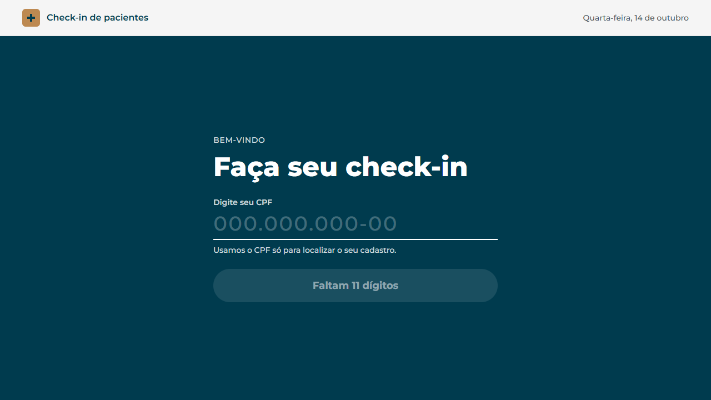
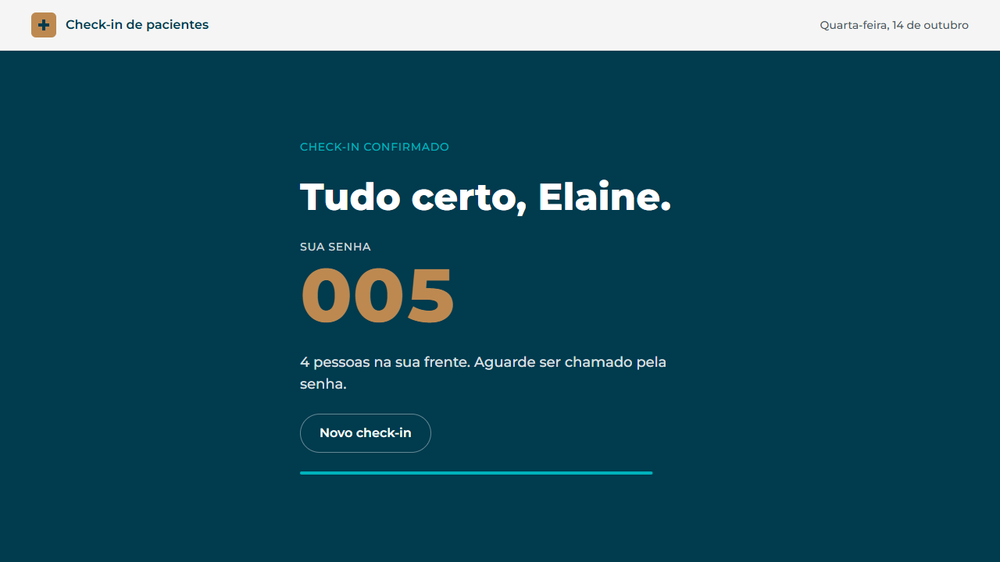
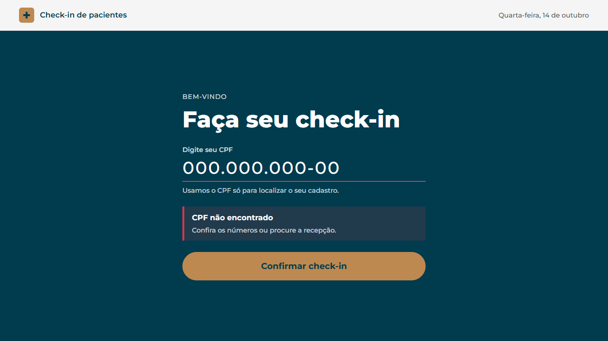
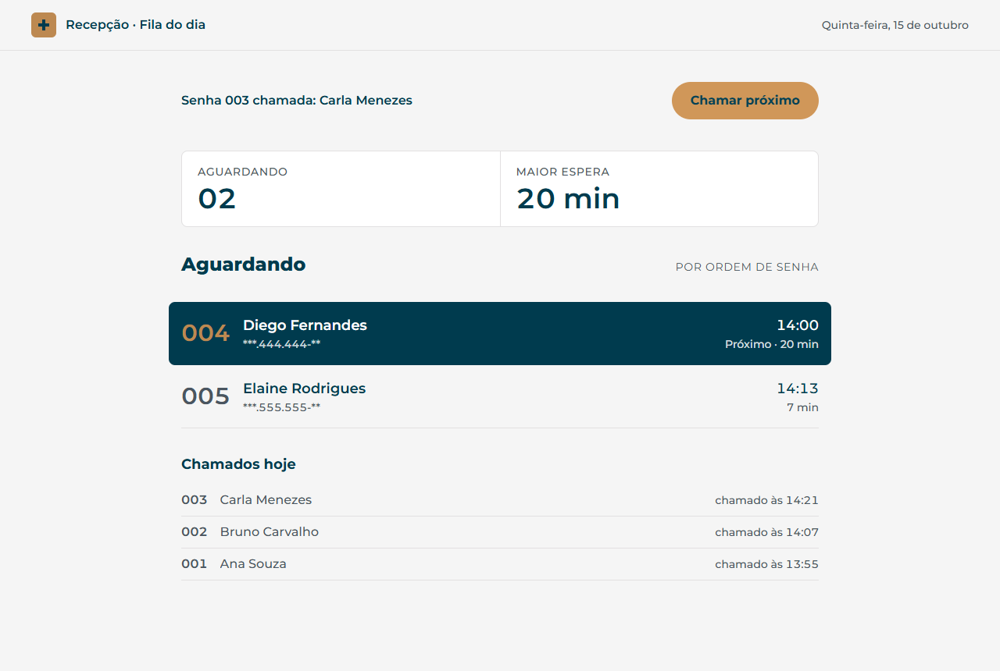
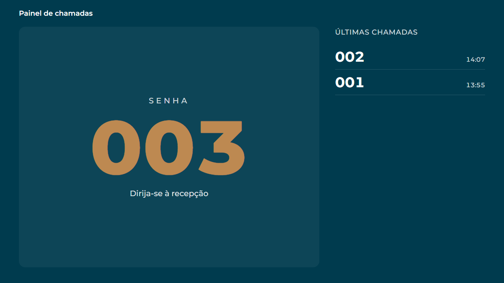

# Entrega: Gabriell Pereira

[](https://github.com/HunterDrakar/dev-junior-challenge/actions/workflows/ci.yml)

Sistema de check-in de pacientes: o paciente informa o CPF no **totem**, a API busca o nome no
serviço de cadastro (`mock-service`), registra a chegada e devolve uma **senha do dia**; a
**recepção**, em outra tela, acompanha a fila e **chama a próxima senha**, que aparece no
**painel** da sala de espera, só com a senha, sem nome.

| Totem | Senha emitida |
| :---: | :---: |
|  |  |
| **CPF fora do cadastro** | **Recepção** |
|  |  |
| **Painel da sala de espera** | |
|  | |

```
web (React, :5173) ──HTTP──▶ api (NestJS, :3000) ──HTTP──▶ mock-service (:4000)
                                   │
                                   └──SQL──▶ PostgreSQL           (ou memória, sem banco)
```

## Como rodar

### Opção 1: Docker (tudo de uma vez)

Pré-requisito: Docker com Compose. As portas `5173`, `3000` e `4000` precisam estar livres
(o PostgreSQL fica só na rede interna do compose).

```bash
docker compose up --build
```

Abra **http://localhost:5173** e escolha a tela: **/totem** (check-in) ou **/recepcao** (fila).
Para ver os dois lados ao mesmo tempo, abra cada um em uma aba. A fila fica salva no PostgreSQL.

### Opção 2: sem Docker (Node.js 22, ou 20.12 ou superior)

Em três terminais, a partir da raiz do repositório:

```bash
# 1) serviço de cadastro (porta 4000)
cd mock-service && npm install && npm start
```

```bash
# 2) API (porta 3000). Sem banco configurado, a fila fica em memória
cd api && npm install && npm run start:dev
```

```bash
# 3) front-end (porta 5173)
cd web && npm install && npm run dev
```

Abra **http://localhost:5173** e escolha **/totem** ou **/recepcao**.

Não é preciso configurar nada: os valores padrão já apontam para `localhost`. Para mudar
algum, copie `api/.env.example` para `api/.env` (ou `web/.env.example` para `web/.env`) e
edite:

| Variável       | Onde | Padrão                  | Para quê                                        |
| -------------- | ---- | ----------------------- | ----------------------------------------------- |
| `CADASTRO_URL` | api  | `http://localhost:4000` | URL do serviço de cadastro                      |
| `DATABASE_URL` | api  | _(vazia)_               | Se definida, usa o PostgreSQL; senão, memória   |
| `PORT`         | api  | `3000`                  | Porta da API                                    |
| `VITE_API_URL` | web  | `http://localhost:3000` | URL da API chamada pelo navegador               |

Se você já tem um PostgreSQL rodando na máquina, dá para usá-lo nesta opção: crie um banco
e descomente/ajuste a `DATABASE_URL` no `api/.env`. A tabela é criada automaticamente.

### Testes

**O teste principal**, da regra do check-in (CPF → cadastro → senha na fila, CPF inexistente,
duplicado, cadastro fora do ar), está em `api/src/checkin/checkin.service.spec.ts`. A
integração com o serviço de cadastro é testada em `api/src/cadastro/cadastro.service.spec.ts`.

```bash
cd api && npm test            # unitários (Jest)
cd api && npm run test:e2e    # rotas HTTP de ponta a ponta (supertest)
cd web && npm test            # front-end (Vitest + Testing Library)
```

**e2e de navegador (Playwright):** abre o Chrome e faz o fluxo inteiro (check-in no totem,
chamada na recepção, senha no painel) com API, banco e cadastro de verdade. Precisa do projeto
de pé (`docker compose up`) e de um banco sem check-ins da Carla no dia:

```bash
cd web && npx playwright install chromium && npm run test:e2e
```

Os testes de integração com o PostgreSQL só rodam se `TEST_DATABASE_URL` apontar para um banco
descartável, com "test" no nome (a tabela é apagada a cada teste). Sem a variável, são pulados.

### Para testar

CPFs que existem no cadastro: `111.111.111-11`, `222.222.222-22`, `333.333.333-33`,
`444.444.444-44`, `555.555.555-55`. Qualquer outro retorna "CPF não encontrado".

## O que foi feito

Todo o escopo mínimo e os quatro desejáveis (Docker, testes, erros na tela e banco relacional).

**API (NestJS)**

| Método | Rota        | O que faz                                                       |
| ------ | ----------- | --------------------------------------------------------------- |
| `POST` | `/checkins` | Recebe `{ "cpf": "..." }`, busca o nome no cadastro, registra a chegada e devolve só `{ primeiroNome, senha, posicao }` |
| `GET`  | `/checkins` | Lista os check-ins de **hoje** (aguardando e chamados), na ordem das senhas |
| `POST` | `/checkins/chamar-proximo` | Chama a menor senha que aguarda (404 se ninguém aguarda) |
| `GET`  | `/chamadas` | Últimas chamadas de hoje, **só com senha e horário**, para o painel público |
| `GET`  | `/health` | API no ar e banco acessível (usado pelo Docker)                 |

Respostas do `POST /checkins`:

| Status | Quando                                         |
| ------ | ---------------------------------------------- |
| `201`  | Check-in registrado: `{ "primeiroNome": "Ana", "senha": 1, "posicao": 1 }` |
| `400`  | CPF vazio ou fora do formato (aceita `111.111.111-11` ou `11111111111`) |
| `404`  | CPF não existe no cadastro                     |
| `409`  | O paciente já fez check-in hoje                |
| `502`  | O cadastro respondeu algo inesperado (sem nome, CPF diferente, corpo que não é JSON, 4xx) |
| `503`  | Serviço de cadastro fora do ar (rede, timeout ou 5xx, depois de 3 tentativas) |

```bash
curl -X POST http://localhost:3000/checkins -H "Content-Type: application/json" -d '{"cpf":"111.111.111-11"}'
curl http://localhost:3000/checkins
```

Organização da API:

```
api/src/
├── cadastro/              cliente HTTP do mock-service (CadastroService)
└── checkin/
    ├── checkin.controller.ts   rotas
    ├── checkin.service.ts      regra de negócio
    ├── dto/                    validação do CPF
    └── repositories/           CheckinRepository + versões em memória e PostgreSQL
```

**Front-end (React)**: duas telas, pensadas para aparelhos diferentes.

- **Totem (`/totem`):** campo único de CPF com máscara e teclado numérico no celular; o botão mostra
  quantos dígitos faltam; cada erro diz o que fazer ("confira os números ou procure a
  recepção"); no sucesso mostra a senha e quantas pessoas estão na frente e volta sozinho para o
  próximo paciente. Se alguém digita o CPF e vai embora, ele some da tela em 30 segundos.
- **Recepção (`/recepcao`):** total na fila e maior espera no topo, próximo paciente em destaque, horário
  de chegada e tempo de espera de cada um. Atualiza sozinha a cada 10 segundos.

**Testes: 144 no total** (131 sem banco nem navegador):

| Onde | Quantos | O que cobrem |
| ---- | :-----: | ------------ |
| API: unitários (Jest) | 39 | regra do check-in (404, 409, senha, posição, inclusive se o paciente for chamado no meio do cálculo), chamada, virada do dia no fuso de Brasília, cliente do cadastro (respostas inválidas → 502, novas tentativas com espera crescente, logs sem CPF nem nome), CORS |
| API: e2e (supertest) | 22 | a API inteira por HTTP: o que cada rota devolve (e o que não devolve), validação do CPF (400), 404, 409, 502/503, chamada, painel, health, CORS |
| API: integração (PostgreSQL real) | 11 | 50 check-ins simultâneos sem senha repetida, mesmo CPF 5 vezes ao mesmo tempo, duas recepcionistas chamando juntas (`SKIP LOCKED`), API sobrevivendo à queda de conexões do banco |
| e2e de navegador (Playwright) | 2 | o fluxo completo pela tela: check-in no totem, chamada na recepção e senha no painel, conferindo que o totem não baixa a fila e que nenhum CPF completo ou nome aparece onde não deve; e o erro de CPF fora do cadastro |
| Front (Vitest + Testing Library) | 70 | máscara do CPF, mensagem de cada erro, tela da senha, volta automática, **CPF apagado do totem após 30 s sem uso**, fila e chamada na recepção, painel, rotas, **totem sem a fila e sem link para outras telas**, atualização atrasada que não desfaz uma chamada |

Para conferir que os testes pegam erros de verdade, quebrei o código de propósito em vários
pontos (fuso em UTC, validação desligada, totem buscando a fila ou com link, sem novas
tentativas, sem `SKIP LOCKED`, cálculo antigo da posição, atualização atrasada sem proteção)
e eles falharam.

## Onde guardei os dados

**PostgreSQL**, quando a variável `DATABASE_URL` está definida (é o caso do Docker), e
**memória** quando não está.

- O banco era desejável e é o mais próximo do real: a fila sobrevive a um reinício da API.
- Mantive a memória como alternativa para quem quiser rodar só com `npm`, sem precisar de
  banco nenhum.
- As duas implementações seguem o mesmo contrato (`CheckinRepository`), então o
  `CheckinService` não sabe onde os dados estão. Isso também deixou os testes simples: eles
  usam a versão em memória.

A tabela é criada pela própria API ao subir (`CREATE TABLE IF NOT EXISTS checkins`), com uma
constraint `UNIQUE (dia, cpf)` que impede dois check-ins do mesmo paciente no mesmo dia.

## Decisões e dificuldades

**Decisões**

- **SQL puro com o driver `pg`, sem ORM.** São poucas consultas; um ORM traria mais
  configuração do que benefício aqui, e o SQL fica visível para revisão (o dia a dia da vaga é
  SQL no Oracle).
- **`fetch` nativo do Node** para chamar o cadastro, sem biblioteca extra. O cliente
  diferencia "CPF não existe" (404 do cadastro → `404` para o totem) de "cadastro fora do ar"
  (erro de rede, timeout ou 5xx → `503`). Para quem está no totem são
  situações diferentes: uma é conferir o CPF; a outra é procurar a recepção.
- **A resposta do cadastro é conferida antes de ser usada (502).** Se vier sem nome, com um
  corpo que não é JSON ou com um **CPF diferente do consultado**, a API recusa com 502 em vez
  de registrar o check-in. O último caso é o mais importante num hospital: nunca associar o
  atendimento ao paciente errado. O log registra só o tipo de problema, sem CPF nem nome.
- **Novas tentativas ao chamar o cadastro.** Uma falha passageira (rede, timeout, 5xx) não
  vira erro na hora: são até 3 tentativas, com espera de ~200 ms e ~400 ms entre elas, mais um
  pouco aleatório para vários totens não tentarem juntos. O timeout por tentativa é de 1,5 s,
  para o pior caso ficar perto de 5 s, já que o paciente está em pé na frente do totem. 404,
  outros 4xx e respostas inválidas não são repetidos, porque tentar de novo não muda o
  resultado.
- **O front não repete o `POST /checkins` sozinho.** O check-in não é idempotente: se o
  primeiro pedido tiver sido gravado e só a resposta se perdeu, a nova tentativa daria 409
  ("já fez check-in") e confundiria o paciente. Em caso de erro, o totem orienta a pessoa.
- **API e front reiniciam sozinhos no Docker** (`restart: unless-stopped`).
- **Um check-in por paciente por dia (409).** O enunciado não fala disso; adotei como
  premissa porque um totem real não deveria colocar a mesma pessoa duas vezes na fila.
  A regra é garantida pela constraint única no banco, e não só por uma consulta antes do
  `INSERT`. Assim, duas requisições simultâneas com o mesmo CPF não passam as duas.
- **CPF validado só pelo formato (11 dígitos).** Não valido os dígitos verificadores porque
  os CPFs de teste do cadastro (`111.111.111-11` etc.) não passariam nessa validação; quem
  decide se o CPF existe é o serviço de cadastro.
- **"Fila do dia" no horário de Brasília.** O horário é salvo em UTC (`TIMESTAMPTZ`) e o
  "hoje" é calculado em `America/Sao_Paulo`, para a fila não virar à meia-noite UTC
  (21h em Brasília).
- **Totem e recepção em telas separadas.** O totem fica de frente para o público; se mostrasse
  a fila, qualquer pessoa veria o nome de quem está esperando. Antes de decidir, pesquisei como
  totens e painéis funcionam em hospitais: a recomendação mais consistente é não exibir nome
  completo em tela pública. Um estudo de caso de hospital em Hong Kong relata que chamar por
  número melhorou a privacidade dos pacientes
  ([Hospital Authority, 2016](https://www.ha.org.hk/haconvention/hac2016/proceedings/downloads/SPPE1121.pdf)).
  Por isso o totem nem busca a fila: a API devolve a posição junto com o check-in.
- **Chamada da próxima senha, com painel sem dados pessoais.** Fecha o ciclo totem → senha →
  chamada. Se duas recepcionistas clicarem ao mesmo tempo, cada uma chama um paciente diferente:
  o `UPDATE` escolhe a menor senha aguardando com `FOR UPDATE SKIP LOCKED` (o Oracle tem o
  mesmo recurso). O painel usa uma rota própria (`/chamadas`) que só devolve senha e horário:
  nenhum nome chega à TV da sala de espera. A posição informada no totem passa a contar só quem
  ainda aguarda.
- **Senha do dia (001, 002...) em vez de chamar pelo nome.** É como funcionam os totens de
  senha integrados a painéis de chamada. A posição na fila muda conforme o atendimento anda;
  a senha não. Ela fica **gravada** no banco (`UNIQUE (dia, senha)`), e não calculada na hora,
  para nunca mudar depois de emitida. Um contador por dia (`senhas_do_dia`, como uma
  *sequence* que recomeça todo dia) é incrementado com `INSERT ... ON CONFLICT DO UPDATE` no
  **mesmo comando** que grava o check-in: o Postgres trava a linha do contador e as senhas
  saem uma de cada vez, sem colisão. Se o check-in é recusado (CPF duplicado), o comando
  inteiro é desfeito e a senha não pula.
- **Fila ordenada pela senha, não pelo horário.** A senha é a ordem real de emissão (veja a
  primeira dificuldade abaixo).
- **Cada rota devolve só o que a tela usa.** O totem recebe o primeiro nome, a senha e a
  posição; a recepção recebe o CPF já **mascarado pela API** (`***.111.111-**`); o painel, só
  senha e horário. O CPF completo nunca sai da API, e o totem não tem link para as outras
  telas.
- **React com Vite, front e back separados.** O back-end já é a API NestJS, então um
  framework com servidor próprio (como o Next.js) ficaria sobrando. No Docker, o build do
  React é servido por um nginx, e a API libera CORS para o front.
- **Tailwind CSS** para os estilos, com as cores e fontes definidas em um só lugar
  (`web/src/index.css`).
- **Visual inspirado no site do hospital**: usei a paleta do site (azul-petróleo, dourado,
  ciano) e a Montserrat, alternativa gratuita à Gotham. **Não usei a logo**: é marca de
  terceiros e o repositório é público.
- **Atualização da fila a cada 10 s (polling)**: simples e suficiente para a recepção ver
  check-ins de outros totens.

**Dificuldades**

- **Senha 5 com posição 2.** Testando vários check-ins ao mesmo tempo, uma paciente recebeu a
  senha 5 e a posição 2. O horário de chegada era marcado um instante antes do `INSERT` e a
  senha no `INSERT`; com requisições simultâneas, as duas ordens divergiam por milissegundos,
  e a fila, ordenada por horário, chamaria a senha 5 antes da 2. Corrigi ordenando a fila pela
  senha, que é a ordem real de emissão.

- **A API caía quando o banco reiniciava.** Testando o `/health` com o PostgreSQL parado, a
  API inteira caiu em vez de responder 503. O pool de conexões do `pg` avisa quando o banco
  derruba uma conexão parada (evento `error`), e no Node um evento de erro sem tratamento
  derruba o processo. Passei a registrar esse evento no log: o pool descarta a conexão e abre
  outra na próxima consulta.

- **O totem tinha um link que levava até a recepção.** Revisando o código, vi que o cabeçalho
  do totem tinha link para a página inicial, e dela para a tela da recepção, com o nome de
  todos os pacientes. Num totem público, dois toques bastariam. Tirei o link do cabeçalho do
  totem e criei um teste que garante isso.

- **Um aviso de "não foi possível conectar" com a API no ar.** Desconfiei de um aviso desses
  na recepção. Investigando, descobri que, aberto por `127.0.0.1` em vez de `localhost`, o
  front era bloqueado pelo CORS: para o navegador, são origens diferentes. Liberei as duas
  origens locais e criei testes para elas.

**Uso de IA**

Usei o Claude Code no desenvolvimento, e ele escreveu a maior parte do código. Antes de partir
para o código, li o material do desafio e montei todo o contexto com ele; ao longo do projeto,
fizemos pesquisas (por exemplo, como funcionam totens e painéis de chamada em hospitais) e
definimos o que entraria e o que ficaria de fora.

Revisei o código manualmente e testei as telas à mão, com os testes automatizados e com o
navegador controlado pelo Claude (*computer use*). Não aceitei tudo de primeira: questionei o
que não fazia sentido, conferi se os testes seguiam o que o enunciado pedia e pedi uma segunda
rodada de code review. Também usei skills que já uso no dia a dia, de front-end e de code
review.

NestJS era novo para mim (eu vinha do Express). Com o Claude, aprendi mais rápido os conceitos
básicos que usei no projeto.

## O que faria com mais tempo

- **Autenticação na recepção.** `GET /checkins` e `chamar-proximo` mostram nomes e não pedem
  login; hoje dependem de a tela ficar na rede interna.
- **Proteger o totem contra consulta de CPF alheio:** quem digita o CPF de outra pessoa vê o
  primeiro nome dela e faz o check-in em seu nome. Limite de requisições por totem e
  confirmação com a data de nascimento (que o cadastro já devolve) resolveriam.
- **Migrations** (por exemplo, com uma ferramenta de migração) em vez de criar a tabela na
  subida da API.
- **Ciclo completo de atendimento:** "em atendimento", "atendido" e "não compareceu",
  rechamar e desfazer uma chamada feita por engano, e guichês ("senha 005 → guichê 2").
- **Atendimento prioritário** (idosos, gestantes e pessoas com deficiência, pela Lei 10.048/2000),
  com senha separada e regra de intercalação. Deixei de fora porque a regra é do hospital.
- **Voz no painel** (síntese de fala) e atualização em tempo real (SSE/WebSocket).
- **Publicar um evento** (RabbitMQ/Kafka/SQS) a cada check-in, para outros sistemas
  reagirem, e atualizar a recepção em tempo real (SSE ou WebSocket) em vez de polling.
- **Circuit breaker** na chamada ao cadastro: se ele estiver caído, parar de tentar por alguns
  segundos e responder 503 na hora, em vez de cada paciente esperar as 3 tentativas. Faz
  sentido com volume maior de totens.
- **Chave de idempotência no `POST /checkins`** (o front manda um id único por tentativa e a
  API devolve o mesmo check-in se receber o id de novo). Com isso, o front poderia repetir o
  pedido com segurança depois de uma falha de rede.
- Cache curto dos pacientes consultados no cadastro.
- **Testes de integração** dos endpoints (supertest com o banco) e testes do front com
  React Testing Library.
- Documentação da API com Swagger, logs estruturados e uma pipeline de CI rodando lint e
  testes a cada push.
